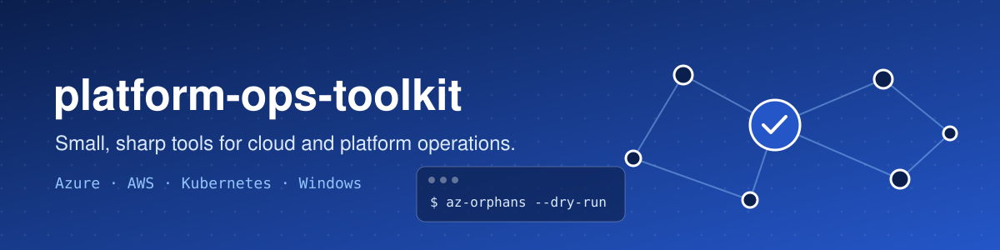
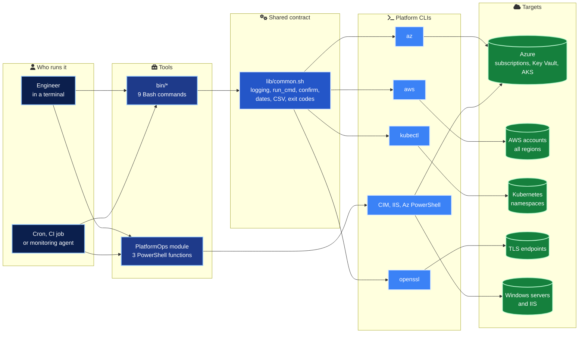
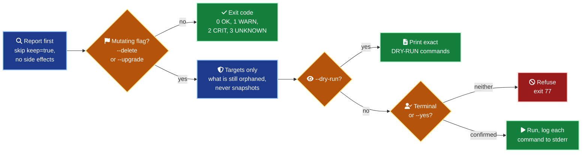
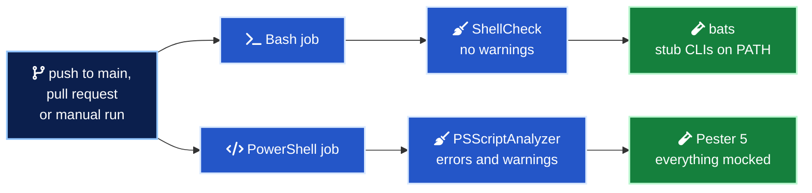

<div align="center">



<h3>Small, sharp command-line tools for day-to-day cloud and platform operations.</h3>


</div>

---

## In numbers

| | |
| --- | --- |
| 12 | Tools, 9 Bash commands and 3 PowerShell functions |
| 4 | Platforms covered (Azure, AWS, Kubernetes, Windows servers and IIS) |
| 109 | bats tests for the Bash tools, all passing |
| 32 | Pester tests for the PowerShell module, every Windows and Az command mocked |
| 22 | Synthetic API fixtures, so no test ever touches a real cloud |
| 0 | ShellCheck warnings allowed |
| 7 | Safety rules every tool follows |
| 7 | Exit codes with one meaning each, readable by a scheduler or a monitoring agent |
| 11 | Documentation pages, one per tool plus the shared conventions |

## What it is

Each tool answers one recurring operational question. Am I in the right context? What expires soon? What are we paying for that nobody uses? Why is this namespace unhealthy?

Every tool answers it the same way. It is read-only by default, explicit about what it changes, honest in its exit codes, and tested. The toolkit is for platform, cloud and operations engineers who want the same small, predictable tools on a macOS laptop, a Linux jump host and a CI runner.

## Architecture



Every Bash tool sources one shared library, so flags, logging, dry run, confirmation and exit codes behave the same everywhere. Data goes to stdout and logs go to stderr, so every report can be piped.

## How a change is gated



## Quick start

Requirements are Bash 3.2 or newer, `jq`, and the CLI of the platform you target (`az`, `aws`, `kubectl`, `openssl`). The PowerShell module needs PowerShell 7.2 or newer.

```bash
git clone https://github.com/marlyngiselle/platform-ops-toolkit.git
cd platform-ops-toolkit

# Install into ~/.local/bin as symlinks (tools find their library through them)
make install

# Or run in place
export PATH="$PWD/bin:$PATH"

cert-expiry --help
context-guard --help

# Run the whole Bash suite offline, against stub CLIs
bats tests
```

```powershell
Import-Module ./powershell/PlatformOps/PlatformOps.psd1
Get-Command -Module PlatformOps
```

`make uninstall` removes what `make install` created. `make install PREFIX=/usr/local` installs system wide.

<details>
<summary>Sample output of <code>cert-expiry</code></summary>

```console
$ cert-expiry www.example.com api.example.com legacy.example.com
HOST                                     PORT   DAYS_LEFT NOT_AFTER             STATUS
www.example.com                          443    364       2027-12-31T00:00:00Z  OK
api.example.com                          443    19        2027-01-20T00:00:00Z  WARNING
legacy.example.com                       443    2         2027-01-03T00:00:00Z  CRITICAL
$ echo $?
2
```

</details>

<details>
<summary>Sample output of <code>az-orphans --dry-run</code></summary>

```console
$ az-orphans -g rg-lab --dry-run
KIND       NAME                             RESOURCE_GROUP       LOCATION       DETAIL                   AGE_DAYS
disk       disk-old-vm-os                   rg-lab               westeurope     128GB Premium_LRS        213
public-ip  pip-old-lb                       rg-lab               westeurope     Standard 203.0.113.10    -
nic        nic-old-vm                       rg-lab               westeurope     10.10.1.4                -
snapshot   snap-2026-03                     rg-lab               westeurope     128GB                    306
DRY-RUN: az disk delete --ids /subscriptions/0000.../disks/disk-old-vm-os --yes
DRY-RUN: az network public-ip delete --ids /subscriptions/0000.../publicIPAddresses/pip-old-lb
DRY-RUN: az network nic delete --ids /subscriptions/0000.../networkInterfaces/nic-old-vm
```

</details>

<details>
<summary>Sample output of <code>context-guard</code> refusing the wrong cluster</summary>

```console
$ context-guard --expect-kube-context 'aks-prod-*' -- kubectl delete namespace scratch
Active context:
  kube     context=aks-dev-weu namespace=payments
[ERROR] context-guard: kube: context 'aks-dev-weu' does not match 'aks-prod-*'
$ echo $?
77
```

</details>

Every example uses synthetic data, with zero GUIDs, the AWS documentation account `111122223333` and the documentation IP ranges `203.0.113.0/24` and `198.51.100.0/24`.

## Tool catalogue

| Tool | What it answers | Platform | Mode |
| --- | --- | --- | --- |
| [`context-guard`](docs/tools/context-guard.md) | Which subscription, account and cluster am I on? Assert it before a risky command runs | Azure, AWS, Kubernetes | Guard, runs your command only after checks and confirmation |
| [`cert-expiry`](docs/tools/cert-expiry.md) | Which TLS certificates expire soon? Nagios-style exit codes, JSON output | Any endpoint | Read-only |
| [`k8s-triage`](docs/tools/k8s-triage.md) | Why is this namespace unhealthy? One Markdown report for the ticket | Kubernetes | Read-only |
| [`az-inventory`](docs/tools/az-inventory.md) | What resources exist, where, and who owns them? CSV with tag columns | Azure | Read-only |
| [`aws-inventory`](docs/tools/aws-inventory.md) | The same question for an AWS account, across regions | AWS | Read-only |
| [`az-orphans`](docs/tools/az-orphans.md) | Unattached disks, idle public IPs, detached NICs, old snapshots | Azure | Read-only, cleanup with `--delete` |
| [`aws-orphans`](docs/tools/aws-orphans.md) | Available EBS volumes, idle Elastic IPs, detached ENIs, old snapshots | AWS | Read-only, cleanup with `--delete` |
| [`kv-secret-expiry`](docs/tools/kv-secret-expiry.md) | Which Key Vault secrets and certificates are expired or expiring? Metadata only | Azure | Read-only |
| [`aks-node-image-check`](docs/tools/aks-node-image-check.md) | Which AKS node pools run an outdated node image? | Azure AKS | Read-only, node image upgrade with `--upgrade` |
| [`Get-ServerHealthSnapshot`](docs/tools/powershell.md#get-serverhealthsnapshot) | CPU, memory, disk, stopped services, pending reboot, error events per server | Windows | Read-only |
| [`Get-IisSiteReport`](docs/tools/powershell.md#get-iissitereport) | IIS sites, app pool state and identity, bindings, certificate expiry | Windows IIS | Read-only |
| [`Test-AzTagCompliance`](docs/tools/powershell.md#test-aztagcompliance) | Which resources break the tagging standard? Optionally merge default tags | Azure | Read-only, tags with `-DefaultValue` (honours `-WhatIf`) |

### Exit codes

| Code | Name | Meaning |
| --- | --- | --- |
| `0` | OK | Success, nothing to report |
| `1` | WARNING | Findings within the warning threshold, or findings with `--fail-on-findings` |
| `2` | CRITICAL | Critical or expired item, or a mutating operation failed |
| `3` | UNKNOWN | The check could not be completed |
| `64` | USAGE | Bad flag, missing or invalid argument |
| `69` | UNAVAILABLE | A required CLI is missing, or there is no signed-in session |
| `77` | REFUSED | Context assertion failed, protected context, or confirmation declined |

When several items are checked, the worst result wins, and `UNKNOWN` never hides a `CRITICAL`.

## Safety and permissions

| Rule | What it guarantees |
| --- | --- |
| Read-only by default | Every tool reports first. Changing anything needs `--delete`, `--upgrade`, or a command after `context-guard --` |
| Dry run is first class | `--dry-run` prints the exact shell-quoted commands, prefixed with `DRY-RUN:`, ready for a pull request or a change request. PowerShell uses `-WhatIf` |
| A human or an explicit opt-in | Without a terminal, a mutating tool refuses unless `--yes` is given, so a cron job never deletes by accident |
| Protected contexts | `context-guard --protect '*prod*'` turns y/N into typing the context name back |
| Opt-out tag | Cleanup tools skip resources tagged `keep=true` (configurable with `--keep-tag`) |
| Snapshots are never deleted | They are the last copy of something. Orphan tools report them and leave the decision to a person |
| Values stay secret | `kv-secret-expiry` reads metadata only, and no tool prints tokens, keys or secret values |

| Tool | Minimum to report | Added for the change flag |
| --- | --- | --- |
| `az-inventory`, `az-orphans`, `aks-node-image-check` | `Reader` | Delete rights scoped to the resource group, or `Azure Kubernetes Service Contributor Role` on the cluster |
| `kv-secret-expiry` | `Key Vault Reader`, or `List` in access policies | none |
| `aws-inventory`, `aws-orphans` | `tag:GetResources` and `ec2:Describe*` | `ec2:DeleteVolume`, `ec2:ReleaseAddress`, `ec2:DeleteNetworkInterface` |
| `k8s-triage` | The built-in `view` ClusterRole bound to the namespace | none |
| `cert-expiry`, `context-guard` | Network reachability, or whatever the wrapped command needs | none |
| `Test-AzTagCompliance` | `Reader` | `Tag Contributor` |

The full contract, including logging, idempotency and portability, is in [docs/conventions.md](docs/conventions.md).

## Continuous integration



Both jobs run on Ubuntu 24.04 with a read-only workflow token and a pinned checkout action. Tests never touch a real cloud. Each suite puts stub `az`, `aws`, `kubectl` and `openssl` executables first on `PATH`, serves synthetic API responses from [`tests/fixtures`](tests/fixtures), freezes the clock, and asserts both the output and the commands that would have been called.

```bash
make check      # lint and test, exactly what CI runs
```

## Before you run it

> [!WARNING]
> Every report only sees what the signed-in identity can read. An empty inventory or orphan list with a narrow role assignment means "nothing visible", not "nothing there". Check the active context with `context-guard` first.

> [!CAUTION]
> `--yes` removes the only interactive stop in a cleanup. Run the same command with `--dry-run` first, review the printed plan, and only then add `--delete --yes` in automation.

> [!NOTE]
> `make lint-ps` and `make test-ps` print a one-line notice and skip when `pwsh` is not installed. CI always runs them, so a green local `make check` without PowerShell does not cover the module.

## Repository map

| Path | Role |
| --- | --- |
| `bin/` | The 9 Bash tools, one file each |
| `lib/common.sh` | Logging, dry-run aware execution, confirmation, dates, CSV |
| `powershell/PlatformOps/` | PowerShell 7 module, `Public/` and `Private/` functions |
| `powershell/tests/` | Pester suites and test helpers |
| `powershell/Invoke-Checks.ps1` | Lint and test entry point used by CI |
| `tests/` | bats suites, the stub helper and synthetic fixtures |
| `docs/` | Shared conventions and one page per tool |
| `.github/workflows/ci.yml` | Lint and test on every push and pull request |

## Documentation

| Document | What it covers |
| --- | --- |
| [Conventions](docs/conventions.md) | Flags, exit codes, logging, safety model, idempotency, least privilege, portability |
| [context-guard](docs/tools/context-guard.md) | Assert subscription, account and cluster before a command runs |
| [cert-expiry](docs/tools/cert-expiry.md) | TLS expiry checks with monitoring exit codes |
| [k8s-triage](docs/tools/k8s-triage.md) | Namespace health report in Markdown |
| [az-inventory](docs/tools/az-inventory.md) and [aws-inventory](docs/tools/aws-inventory.md) | Resource inventories with tag columns |
| [az-orphans](docs/tools/az-orphans.md) and [aws-orphans](docs/tools/aws-orphans.md) | Unused resources and guarded cleanup |
| [kv-secret-expiry](docs/tools/kv-secret-expiry.md) | Key Vault expiry from metadata only |
| [aks-node-image-check](docs/tools/aks-node-image-check.md) | Outdated AKS node images and guarded upgrade |
| [PowerShell module](docs/tools/powershell.md) | Server health, IIS report, tag compliance |

---

<div align="center">
<sub>MIT licensed · © 2026 Giselle Da Costa · <a href="LICENSE">LICENSE</a></sub>
</div>
